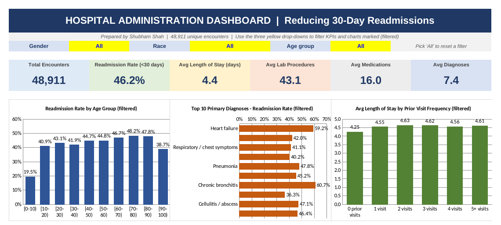
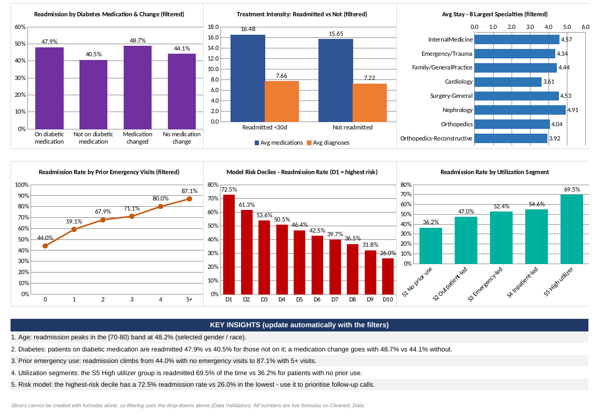

# Hospital Administration Analysis: Reducing 30-Day Readmissions

**Microsoft Excel | Healthcare Analytics | Formula-Driven Analysis | Interactive Dashboard**

Prepared by **Shubham Shah**

---

> Three yellow drop-downs (Gender, Race, Age group) filter the KPI cards, most charts and the insight lines. Slicers cannot be created with formulas alone, so Data Validation drop-downs are used instead.

### KPI Cards and Key Charts (close-up)



---

### More Charts and Auto-Updating Insights



**What each chart shows**

| Chart | What it tells the hospital |
|---|---|
| Readmission Rate by Age Group | Risk rises with age and peaks at 70-80 |
| Top 10 Primary Diagnoses | Heart failure and chronic bronchitis have the highest readmission rates |
| Avg Stay by Prior Visit Frequency | Stay is shortest for patients with no prior visits |
| Readmission by Diabetes Medication and Change | Patients on diabetic medication, and those whose medication changed, are readmitted more |
| Treatment Intensity: Readmitted vs Not | Readmitted patients have more medications and diagnoses |
| Avg Stay, 8 Largest Specialties | Compares bed-day demand across specialties |
| Readmission by Prior Emergency Visits | Rate climbs from 44.0% to 87.1% as emergency visits increase |
| Model Risk Deciles | Highest-risk decile is readmitted 72.5% of the time vs 26.0% in the lowest |
| Readmission by Utilization Segment | High utilizers are readmitted 69.5% vs 36.2% with no prior use |

---

## 1. Project Overview

A large hospital has seen a spike in 30-day readmissions, which raises costs, strains beds and may point to gaps in the quality of care. In this project I act as a data analyst in the hospital administration department. I analyse 66,587 raw admission records to find who gets readmitted, what is associated with it, what it costs and which interventions are worth testing.

Everything is built in Excel. **No answer is typed in by hand: every number in the analysis sheets is a live formula** (COUNTIFS, AVERAGEIFS, CORREL, SLOPE, SUMPRODUCT, PERCENTILE, NORMSDIST and so on) pointing at named ranges on the cleaned data.

### Objectives
- Find patterns and factors associated with 30-day readmission.
- Answer all 25 assignment questions (10 Basic, 10 Medium, 5 Advanced).
- Build a risk score, a patient segmentation and a follow-up programme estimate.
- Present the results in an interactive dashboard for hospital stakeholders.

### Stakeholders
Board and C-suite (cost and quality), department heads (capacity and staffing), clinicians (risk and treatment patterns), payers and regulators (readmission performance), and patients and caregivers.

---

## 2. Dataset

| Item | Detail |
|---|---|
| Source | Hospital Administration Data (Kaggle: `shivavashishtha/hospital-administration-data`) |
| Raw records | 66,587 rows x 49 columns (provided separately as `Hospital_Dataset.csv`; not embedded in the workbook, to keep it under 25 MB) |
| Records after cleaning | 48,911 unique encounters |
| Target | `readmitted` (1 = readmitted within 30 days, 0 = otherwise) |
| Key fields | demographics (race, gender, age), `time_in_hospital`, `medical_specialty`, lab and procedure counts, medications, prior outpatient / emergency / inpatient visits, `diag_1`-`diag_4`, `number_diagnoses`, medication indicators `X1`-`X25`, `change`, `diabetesMed` |

**Not available in the dataset:** admission or discharge dates, discharge disposition, cost, patient satisfaction, mortality, income, insurance and zip code. Questions that need these are answered with a clearly labelled proxy, or marked as not available. Nothing is invented.

---

## 3. Requirements

**Functional**
- Clean the raw data and document every change.
- Use Excel formulas for all answers, not pasted values.
- Show the method for each question, the result and the business impact.
- Provide a dashboard with KPIs, charts and filters.

**Technical**
- Microsoft Excel 2016 or later (the file is set to recalculate when opened).
- About 18 MB of disk space. First open can take a minute because the workbook holds roughly 393,000 formulas.

---

## 4. Tools and Technologies

| Area | Used |
|---|---|
| Spreadsheet | Microsoft Excel (named ranges, conditional formatting, Data Validation, native charts) |
| Formulas | COUNTIFS, AVERAGEIFS, SUMIFS, CORREL, SLOPE, INTERCEPT, RSQ, PERCENTILE, SUMPRODUCT, INDEX / MATCH, LARGE / SMALL, TDIST, NORMSDIST, EXP |
| Statistics in Excel | Correlation t-test, two-proportion z-test, Welch t-test, ROC / AUC by the trapezoid rule, decile lift |
| Python (supporting only) | pandas and scikit-learn to fit the logistic-regression coefficients once, and to cross-check results. The Excel sheets do all scoring and reporting. |

---

## 5. Workbook Structure

| Sheet | Purpose |
|---|---|
| `Project_Overview` | Business problem, live dataset summary, clickable navigation |
| `Dashboard` | 6 KPI cards, 9 charts, drop-down filters, auto-updating insights |
| `Answers_Summary` | One-page answers to all 25 questions, pulled live from the analysis sheets |
| `Basic_Analysis` | Basic Q1-Q10 |
| `Medium_Analysis` | Medium Q1-Q10 |
| `Risk_Model` | Advanced Q1: logistic risk score, confusion matrix, ROC / AUC, lift by decile, risk tiers |
| `Advanced_Analysis` | Advanced Q2-Q5: segmentation, financial impact, social factors, follow-up programme |
| `Dash_Data` | Filter-driven tables that feed the dashboard charts |
| `Data_Cleaning` | Step-by-step cleaning log with raw-file counts and live cleaned counts |
| `Cleaned_Data` | Analysis dataset plus formula helper columns (age mid-point, comorbidity band, utilization segment, risk probability and others) |

Blue text on a yellow background marks an input or assumption that can be changed. Everything depending on it recalculates.

---

## 6. Approach (Step by Step)

1. **Inspect the data.** Profiled all 49 columns, missing values, ranges and duplicates.
2. **Clean it.** Removed duplicates; replaced `?` with `Unknown` / `Not Recorded`; renamed `>200` to `200+` (so COUNTIF does not read it as a comparison); labelled blank X1 / X2 as `Not Tested`; checked `readmitted` holds only 0 or 1.
3. **Add helper columns** as formulas, so the logic stays visible.
4. **Answer each question** with a repeatable layout: steps, formula table, tested result, written answer, business impact.
5. **Test significance with formulas**, not only compare percentages.
6. **Model and simulate:** risk score on a 70% train / 30% test split, rule-based segments, cost and programme scenarios with editable assumptions.
7. **Build the dashboard** on top of filter-aware helper tables.

---

## 7. Challenges Faced

| Challenge | How it was handled |
|---|---|
| **Duplicate rows:** 17,676 rows were exact copies (same encounter and patient), inflating the data from 48,911 to 66,587 records. | Removed them and logged the before / after counts. The readmission rate barely moved (46.2% before and after). |
| **The CSV in the repo was a placeholder.** | Used the 66,587-row `Raw_Data` sheet from the reference workbook instead. |
| **Missing and coded values:** weight is missing for about 97% of encounters, specialty for about half. | Reported completeness first, flagged small groups and avoided firm conclusions on sparse data. |
| **`?` and `>200` behave as special characters in COUNTIF** (wildcard and comparison). | Renamed values in the cleaned data; used `~?` where the raw data is counted. |
| **Missing fields for several questions** (dates, discharge disposition, satisfaction, mortality, cost). | Stated this on the sheet, used labelled proxies where sensible, and left assumptions as editable inputs. |
| **No formula-only way to run logistic regression or K-means.** | Fitted logistic coefficients once in Python and stored them as inputs, with Excel scoring and evaluating everything. Used transparent rule-based segments instead of K-means. |
| **Large workbook** (about 393,000 formulas). | Used named ranges and efficient COUNTIFS / AVERAGEIFS instead of heavy array formulas. |
| **No slicers with formulas.** | Built drop-down filters driven by wildcard criteria. |
| **Drug columns X1-X25 are unlabelled.** | Analysed them as indicators only and did not claim which drug each one is. |

---

## 8. Key Insights

Overall readmission rate: **46.2%** across 48,911 encounters.

- **Age:** readmission peaks in the 70-80 band (48.2%) and stays high through 80-90; patients aged 10-50 sit lower (about 41-45%; the 0-10 group has only 77 encounters).
- **Prior emergency visits are a strong signal:** 44.0% readmitted with no emergency visit, rising to 87.1% with 5 or more.
- **Diabetes:** 77% of encounters involve diabetic medication, and those patients are readmitted 47.9% of the time versus 40.5% for the rest. They account for about 80% of all readmissions.
- **Medication change:** readmission is 48.7% when diabetic medication was changed versus 44.1% when it was not (a statistically significant difference).
- **Length of stay:** each extra medication adds about 0.17 days (r = 0.47). Stay grows from 2.9 days (1-10 medications) to 8.6 days (41+).
- **Comorbidity:** patients with 1-3 diagnoses are readmitted 32.9% of the time; those with 7 or more, 49.6%.
- **Utilization segments:** the "High utilizer" segment (16% of encounters) has a 69.5% readmission rate, versus 36.2% for patients with no prior visits.
- **Risk model:** modest but useful (AUC about 0.65 on unseen test rows). The top risk decile is readmitted 72.5% of the time versus 26.0% in the lowest decile. Prior inpatient and emergency visits are the strongest predictors.
- **Lab volume, outpatient visits, gender and weight** show weak or negligible links once other factors are considered.
- **Readmitted encounters use about 48% of all bed-days.**
- **Data quality is itself a finding:** weight (3.2% recorded) and specialty (about 49% missing) are too incomplete to guide decisions.

> These are associations, not proof of cause. Sicker patients receive more medications and more tests, so treat the drug-level results as a screening list for clinician review.

---

## 9. Recommendations

1. **Target follow-up by risk tier.** Use the risk score to enrol high-risk patients in a programme: medication reconciliation on discharge day, a call within 48 hours, a clinic or tele-visit within 7 days, and weekly calls for 30 days. Keep low-risk patients on a light pathway.
2. **Flag simple triggers at discharge:** 2 or more prior emergency visits, 2 or more prior inpatient stays, a diabetic-medication change, and 7 or more diagnoses.
3. **Strengthen diabetes care:** pharmacist-led medication review, education and glucose follow-up for patients on changed medication.
4. **Plan capacity around complexity:** use medication count and comorbidity band to forecast longer stays and discharge-planning workload.
5. **Fix data capture:** record weight, specialty, admission and discharge dates, discharge disposition, insurance type and zip code at registration. This unlocks seasonality, disposition, equity and cost analysis.
6. **Link outcome and experience data:** add patient satisfaction (for example survey scores) and mortality or long-term outcomes, then reuse the same formula layouts.
7. **Replace assumptions with hospital data:** the cost per readmission ($15,000), the avoidable share (27%), programme reach, effectiveness and cost per patient are placeholders. Update the yellow cells before presenting savings to the Board.
8. **Pilot before scaling:** compare enrolled and similar non-enrolled patients monthly, retrain the model regularly, check accuracy by race and gender, and keep clinicians in the loop.
9. **Ethics and privacy:** keep the data de-identified, leave race and gender out of the risk score, and validate any model with clinical experts before use.

---

## 10. How to Use

1. Download `Hospital_Readmission_Analysis.xlsx` (about 18 MB) and open it in Excel; wait for the recalculation to finish on first open.
2. Start on `Dashboard`, then read `Answers_Summary`.
3. Change any yellow input (minimum sample size, cost, avoidable share, programme reach, risk cut-offs) and watch the results update.
4. Use `Data_Cleaning` to see what was changed and why.

---

## 11. Limitations

- Results are per encounter, not per patient (some patients have several encounters).
- The dataset has no dates, so trends over time cannot be tested. The Medium Q1 sheet uses encounter-ID order as a proxy and says plainly that it is not a real time trend.
- Cost, programme and avoidable-readmission figures are assumptions, not measured values.
- The risk model has modest accuracy and is meant to prioritise follow-up, not to decide care.
- Charts and formulas were verified by recalculation in LibreOffice; open the file in Excel to confirm layout on your machine.

---

## 12. Repository Structure

```
Hospital-Readmission-Analysis
|-- Dashboard_Charts_Insights.png
|-- Dashboard_KPIs_Charts.png
|-- Hospital_Dataset.csv
|-- Hospital_Readmission_Analysis.xlsx
|-- Problem_Statement_Hospital_Data.docx
`-- README.md
```

| File | Description |
|---|---|
| `Dashboard_Charts_Insights.png` | Dashboard screenshot: charts and key insights |
| `Dashboard_KPIs_Charts.png` | Dashboard screenshot: KPI cards and key charts |
| `Hospital_Dataset.csv` | Original raw dataset |
| `Hospital_Readmission_Analysis.xlsx` | Full Excel workbook: cleaned data, analysis of all 25 questions, risk model and dashboard |
| `Problem_Statement_Hospital_Data.docx` | Case study and problem statement |
| `README.md` | Project documentation (this file) |

---

## Author

**Shubham Shah**
Excel | Data Analytics | Healthcare Analytics Portfolio Project
